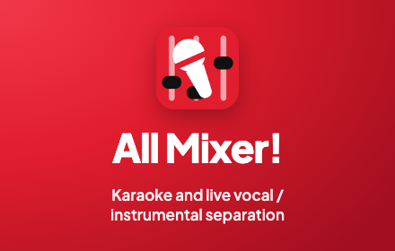
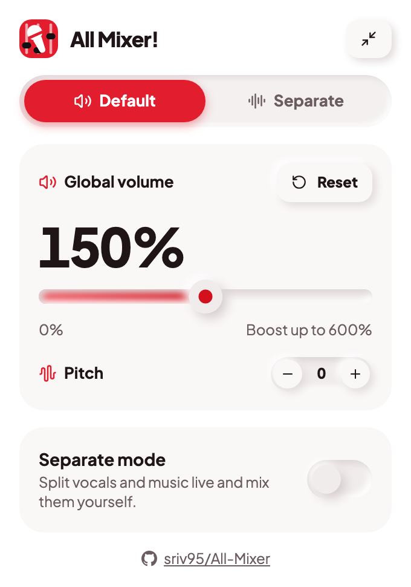
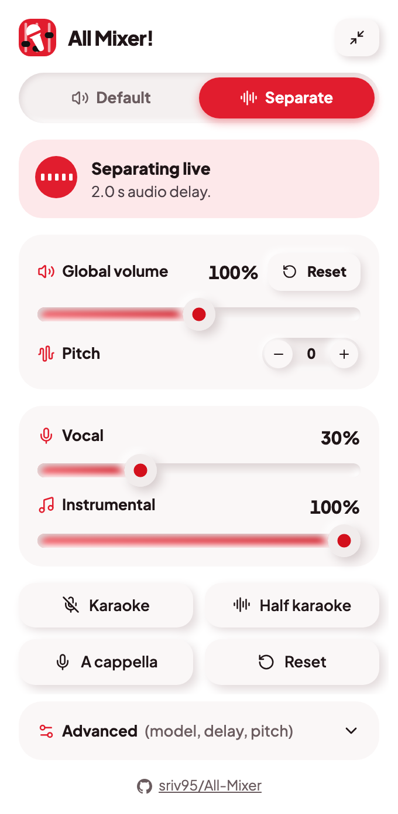
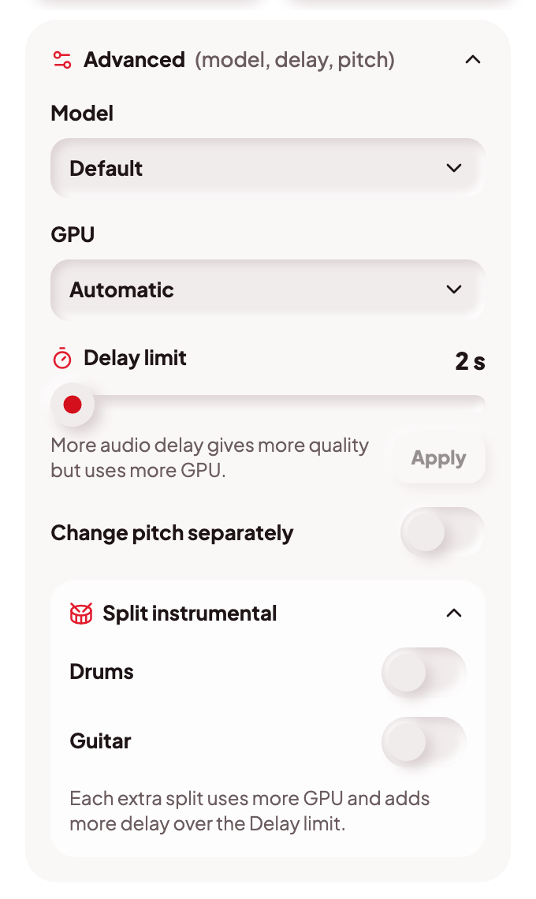
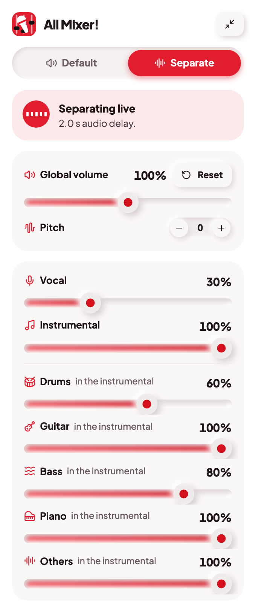

# All Mixer!

Chrome extension for turning browser into Karaoke (live vocal/instrumental separation)

- **Boost sound.** Global volume goes up to 600 %, with a limiter that keeps the sound clean.
- **Separate mode.** Mix the vocal and the instrumental of any song live: turn the singer down for karaoke, or turn the band down to hear the voice. Optional Split instrumental gives drums, guitar, bass and piano their own levels.
- **Pitch.** Shift the pitch up or down by up to 6 semitones. The speed stays the same.
- **Synced lyrics.** Lyrics follow the song on YouTube and YouTube Music, as a floating panel, a karaoke overlay, or the native Lyrics tab.

| Separate mode | Advanced | Focus Instrumental Splitting |
| :---: | :---: | :---: |
|  |  |  |

## Install

### Chrome Web Store (recommended)

Click **Add to Chrome**, then reload any open YouTube tabs and click the toolbar icon.

### GitHub Releases

1. Download `all-mixer-vX.Y.Z.zip` from the [latest release](../../releases/latest) and unzip it.
2. Open `chrome://extensions` and turn on **Developer mode**.
3. Click **Load unpacked** and pick the unzipped folder.
4. Reload any open YouTube tabs, then click the toolbar icon.

## Use

1. Open a video on youtube.com or music.youtube.com and click the All Mixer! icon.
2. Move **Global Volume** to boost the sound.
3. Tick **Separate mode** to mix vocal and instrumental. The first time, the popup offers a one-time model download for the higher quality models. Separate mode needs a computer with a GPU (WebGPU).
4. Under **Advanced** you can change the model, the delay limit, the GPU and Split instrumental.

Separate mode delays the sound by about 2 seconds; the picture is delayed by the same time so they stay in sync. A longer delay limit gives a cleaner split.

## Privacy

Everything runs on your computer. The extension only contacts the lyrics service LRCLIB (for lyrics) and Hugging Face (to download the models you choose). Read the full [Privacy Policy](PRIVACY.md).

## Report a bug or request a feature

Open an issue on GitHub and pick the form:

- [Report a bug](https://github.com/sriv95/All-Mixer/issues/new?template=bug_report.yml)
- [Request a feature](https://github.com/sriv95/All-Mixer/issues/new?template=feature_request.yml)

Search [existing issues](https://github.com/sriv95/All-Mixer/issues) first; add a 👍 or a comment if yours is already there.

## For developers

Build, architecture, model publishing and debug notes are in [src/README.md](src/README.md).

## License

[MIT with Commons Clause](LICENSE): free to use, modify and share, but you may not sell the software.

## Credits

- [Spleeter](https://github.com/deezer/spleeter) (Deezer)
- Default Model: [MDX-Net](https://github.com/Anjok07/ultimatevocalremovergui) 
- High-Quality Model: [Kim-Mel-Band-Roformer-FT](https://huggingface.co/pcunwa/Kim-Mel-Band-Roformer-FT)
- Best-Vocal Model: [mel-band-roformer-deux](https://huggingface.co/becruily/mel-band-roformer-deux)
- Drum Splitting Model: [SCNet](https://github.com/starrytong/SCNet) , ( Tran Small checkpoint from [ZFTurbo](https://github.com/ZFTurbo/Music-Source-Separation-Training) )
- Focus Instrumental Splitting Model: [BS-RoFormer-SW-6stem](https://huggingface.co/FractalSurfer/BS-RoFormer-SW-6stem)

Licenses of the bundled models are in [THIRD_PARTY_NOTICES.txt](public/ml/THIRD_PARTY_NOTICES.txt).